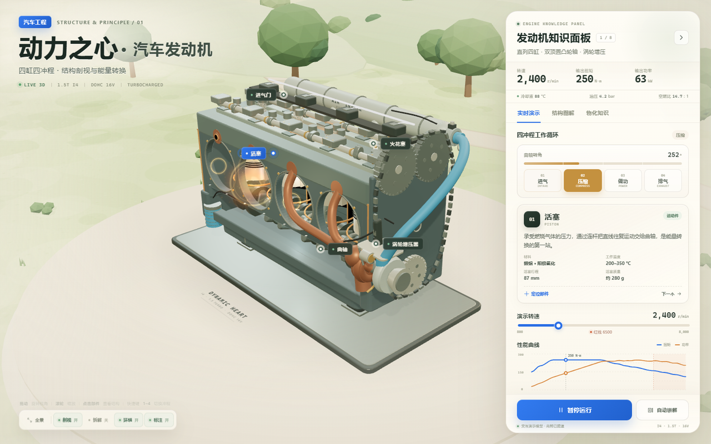
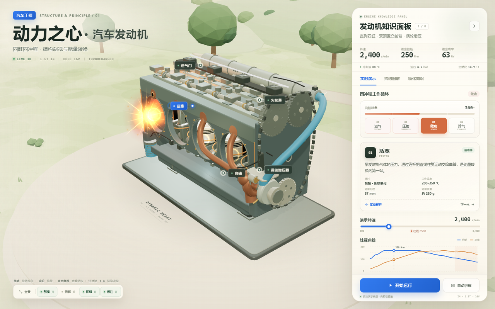
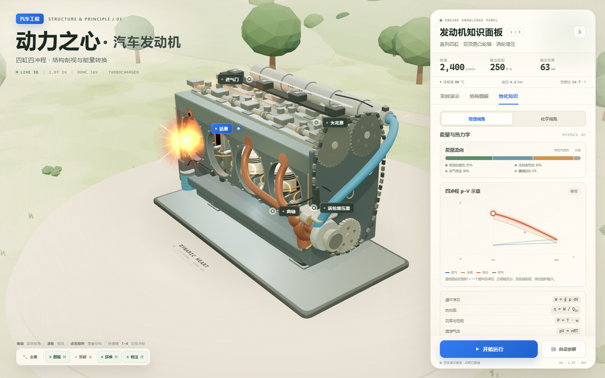

# 3D Project

一个交互式 3D 网页项目集合：

- **汽车发动机 3D 智能剖视** —— 独立目录 [`engine-3d/`](engine-3d/)，入口为 [`engine-3d/index.html`](engine-3d/index.html)
- **心脏 3D 解剖** —— 原有项目，保留在 [`heart-3d/`](heart-3d/) 和 [`heart-3d-original/`](heart-3d-original/) 中

---

## 汽车发动机 3D 智能剖视

一个可交互的汽车直列四缸涡轮增压发动机 3D 网页。以奶油纸色、鼠尾草绿和低多边形等距场景为视觉语言，结合实时机械运动、能源数据与物理/化学知识面板。

页面是**单文件、离线可用**的：Three.js、CSS 和交互脚本已全部内联到 `engine-3d/index.html`，不依赖 CDN 或后端。

### 预览

#### 主界面


#### 点火与燃烧爆炸


#### 物化知识面板


### 功能

- **3D 四缸发动机剖视**：活塞、连杆、曲轴、凸轮轴、16 气门、正时链条、涡轮增压器、进排气与点火系统
- **四冲程实时动画**：进气、压缩、做功、排气与曲轴转角同步，包含点火、燃烧火球和冲击波效果
- **多角度交互**：拖动旋转、滚轮缩放、双击复位、自动环绕
- **8 个可查部件**：点击 3D 标注或右侧列表切换说明
- **模型状态**：透明剖视 / 实体外观、部件拆解、标注开关
- **实时数据**：800–8000 r/min 演示转速，红线 6500；扭矩、功率和性能曲线随转速更新
- **物化知识**：能量流向、动态 p–V 图、热效率公式、压缩比、燃烧方程、空燃比、辛烷值、排放与三元催化
- **自动讲解**：按顺序聚焦部件并同步更新知识面板
- **响应式布局**：窄屏知识面板变为可折叠的底部卡片

### 操作

| 操作 | 功能 |
| --- | --- |
| 拖动 / 滚轮 | 旋转 / 缩放 |
| 双击 | 复位视角 |
| 点击 3D 标注 | 聚焦部件 |
| `1`–`4` | 切换四冲程 |
| `空格` | 运行 / 暂停 |
| `R` | 复位视角 |
| `E` | 拆解 / 合并 |
| `L` | 显示 / 隐藏标注 |
| `P` | 折叠 / 展开知识面板 |
| `Esc` | 停止讲解 / 展开面板 |

点击知识面板中的 **“做功”** 冲程，可以暂停在点火瞬间仔细查看燃烧效果。

### 技术栈

- HTML5 / CSS3 / 原生 JavaScript（ES6+）
- Three.js r160 + WebGL
- 程序化几何建模与 Canvas 纹理，没有外部 3D 模型或贴图
- `requestAnimationFrame` 驱动机械、燃烧与 p–V 标记动画
- 单文件离线构建：`engine-3d/src/build.py` 将样式、脚本和 Three.js 内联到 `engine-3d/index.html`

### 本地运行

直接双击 `engine-3d/index.html` 即可。

如果浏览器对本地文件有限制，也可以起一个静态服务器：

```bash
python -m http.server 8000
```

然后打开 <http://localhost:8000/engine-3d/>。

### 目录结构

```text
.
├─ engine-3d/                 # 完整发动机项目
│  ├─ index.html              # 发动机页面入口
│  ├─ assets/                 # 预览图片
│  ├─ src/                    # 源码和构建脚本
│  └─ README.md               # 发动机项目说明
├─ heart-3d/                  # 心脏 3D 项目
├─ heart-3d-original/         # 心脏 3D 原始版本
├─ .nojekyll
└─ README.md
```

### 修改源码

编辑 `engine-3d/src/` 下的文件后，在项目根目录运行：

```bash
python engine-3d/src/build.py
```

即可重新生成自包含的 `engine-3d/index.html`。

### 部署到 GitHub Pages

1. 打开仓库 **Settings → Pages**。
2. Source 选择 **Deploy from a branch**。
3. Branch 选择 `main`，目录选择 `/ (root)`，保存。
4. 页面会发布在 `https://<用户名>.github.io/<仓库名>/engine-3d/`。

## 其他项目

### 心脏 3D 解剖

原有项目，入口和说明见：

- [`heart-3d/`](heart-3d/)
- [`heart-3d/README.md`](heart-3d/README.md)
- [`heart-3d.html`](heart-3d.html)

## 说明

- Three.js 以 MIT License 内联；其版权声明保留在 `engine-3d/index.html` 和 `engine-3d/src/vendor/three.min.js` 中。
- 本项目未附项目级开源许可证。如果打算公开发布并允许他人复用，建议补充 MIT 或其他许可证。
- 发动机模型、参数与知识内容用于交互演示和教学示意，不作为工程设计依据。
